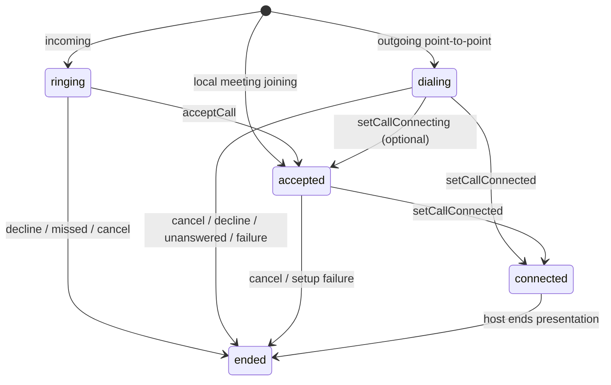

# Outgoing calls and meeting presentations

The host owns signaling, media and meeting permissions. The plugin records
presentation state, renders supported UI, and emits durable events. Starting a
presentation does not dial a network peer or join a room.

## Scenes and controls

| Scene | State / content | Default notification controls |
| --- | --- | --- |
| Incoming point-to-point call | `ringing`, incoming media subtitle | Accept / decline |
| Incoming meeting invitation | `ringing`, invitation | `joinMeetingText` / decline |
| Outgoing point-to-point call | `dialing`, `outgoingText` | Cancel call |
| Outgoing peer answered, media pending | `accepted`, `connectingText` | Hang up |
| Connected point-to-point call | `connected`, `ongoingText` | Hang up |
| Locally created/joined meeting | `accepted`, `joiningMeetingText` + number | Open host app only |
| Meeting connected | `connected`, `meetingText` + number | Open host app only |
| Invite another participant while in a meeting | Keep the same meeting presentation | No additional call |

`joinMeetingText` defaults to “加入会议” / “Join meeting”. An explicit
meeting-specific value overrides a generic accept label; otherwise legacy or
shared accept overrides continue to apply. SDK default banners inherit these
labels instead of hardcoding their own strings.

Android renders local presentations as quiet notifications without incoming
ringtone, vibration or a full-screen intent. Point-to-point outgoing Telecom
uses the outgoing connection path and stays dialing until media is connected.
Meetings do not register a new phone-style Telecom connection, and ongoing
meeting notifications have no hangup action. An incoming invitation may still
use incoming UI with accept/decline actions; after acceptance those actions are
removed. `IncomingCallActivity` also hides hangup for an ongoing meeting.

iOS and Web persist local presentations for host UI and recovery. They do not
post an incoming notification, show an incoming banner or ring for an outgoing
call or locally joined meeting. This does not introduce iOS CallKit or a Web
system-call UI. `CallBannerHost` continues to display incoming ringing calls only.

## State transitions



## API

```dart
final calls = FlutterUnifiedCall.instance;
await calls.startOutgoingCall(OutgoingCallConfig(
  callId: 'unique-call-id',
  displayName: 'Peer',
  mediaType: CallMediaType.video,
  expiresAt: DateTime.now().toUtc().add(const Duration(seconds: 60)),
));
// Optional: signal that the peer answered while media is still connecting.
await calls.setCallConnecting('unique-call-id');
// Call only after the host's connection criterion is satisfied.
await calls.setCallConnected('unique-call-id');
// Close the presentation after ending the active media/signaling session.
await calls.endCall('unique-call-id', reason: CallEndReason.localEnded);
```

`setCallConnected` may also advance an outgoing dialing call directly when the
host receives a combined peer-answer/media-success callback. `setCallConnecting`
is optional and does not connect media or mark Android Telecom active. Use
`endCall(id, reason: CallEndReason.cancelled)` to cancel during setup.

For a locally created or directly joined meeting:

```dart
await calls.startOutgoingCall(OutgoingCallConfig(
  callId: 'unique-meeting-presentation-id',
  displayName: 'Weekly sync',
  kind: CallKind.meeting,
  expiresAt: DateTime.now().toUtc().add(const Duration(seconds: 60)),
  extra: {'meetingName': 'Weekly sync', 'meetingNumber': '00123456'},
));
// After this device has actually joined the room:
await calls.setCallConnected('unique-meeting-presentation-id');
```

Use `updateCall` to persist names and extra metadata learned after setup. The
presentation ID is separate from a reusable room number; use a new presentation
ID for a later session. Meeting numbers are strings, preserving leading zeros.

Leaving a meeting and ending it for everyone are SDK operations with different
permission checks. After that business operation completes, use `endCall` only
to close the plugin presentation. Inviting participants does not call
`startOutgoingCall` again. The plugin never chooses whether to terminate a room.

## Data, events and expiry

- Every new Flutter payload includes typed `direction` (`incoming`/`outgoing`)
  and `kind` (`pointToPoint`/`meeting`). `IncomingCallConfig` remains the common
  snapshot/event model; `OutgoingCallConfig` extends it with outgoing direction.
- Old payloads without these fields still decode. The legacy `extra.meeting`
  and `extra.outgoing` flags are fallback values; explicit fields take precedence.
- Local presentations emit `started`, an optional `connecting`, then `connected`
  and `ended`. They do not generate an `incoming` event. Existing event consumers
  with exhaustive switches must handle the new event types and `dialing` state.
- `expiresAt` is an absolute setup deadline. It applies while dialing or joining,
  and is cancelled after connection. An outgoing call expiring before connection
  emits `ended` / `unanswered`; a peer-answered media setup or local meeting join expiring emits `ended` /
  `failed`. Neither produces an incoming `missed` event.
- Cancel, peer decline and setup failure are represented separately by
  `cancelled`, `declined` and `failed`. Native Android cancel actions record
  cancellation before connection, and local end after connection.
- Native process recreation ends stale local media presentations with `failed`;
  the plugin cannot restore an external media engine. Web tabs share state and
  cannot infer another tab's media lifetime, so setup deadlines and host cleanup
  remain authoritative. Alarm/Worker delivery remains subject to OS policies.

The package demo provides incoming, outgoing and joining-meeting simulations.
Its media-connected and peer-answer buttons simulate host callbacks; they do
not operate a signaling server or media engine. Native changes require a full
host rebuild/reinstall, not hot reload.

When updating the packaged Web scripts, reload the page and update/activate the
host-owned Worker adapter so all entry points use the same core version. Dart
hot reload does not replace an already imported JavaScript/Worker runtime.
